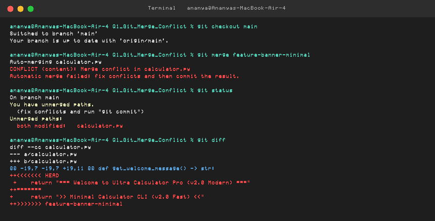
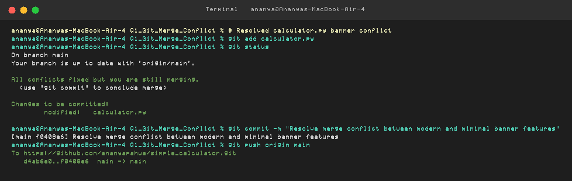
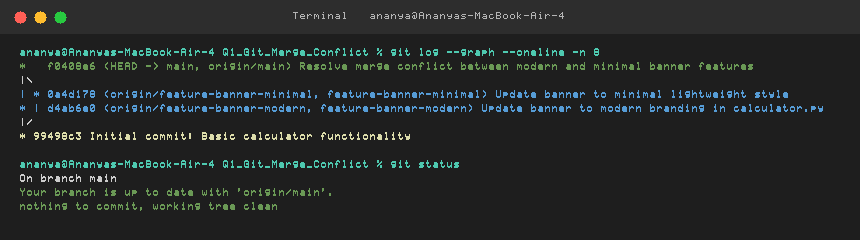

# Simple Calculator & Git Merge Conflict Demonstration

**Course:** UCS 745 Cloud and DevOps  
**Repository:** [https://github.com/ananyapahwa/simple_calculator](https://github.com/ananyapahwa/simple_calculator)  
**Author:** Ananya Pahwa  

---

## 📸 Assignment Screenshots

### 1. Conflict Detection (`git merge` & `git diff`)
When merging branch `feature-banner-minimal` into `main` after `feature-banner-modern` had already been merged, Git identified competing modifications on the exact same line in `calculator.py`.

---

### 2. Manual Conflict Resolution & Staging (`git status`)
The conflict markers were reconciled into a unified banner (`=== Calculator CLI Pro v2.0 (Modern & Lightweight) ===`), and the file was staged using `git add`.

---

### 3. Divergence & Merge Log Graph (`git log --graph`)
Visualization of the commit history showing branch creation, concurrent commits, and the final resolution merge commit into `main`.

---

## 📄 Documentation
- [Reflective Note (Full 1-2 Page Report)](REFLECTIVE_NOTE.md)
- [Step-by-Step Command Guide](STEP_BY_STEP_GUIDE.md)
